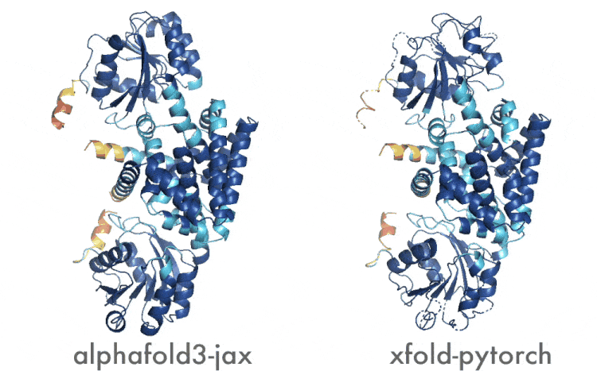

# xfold: Democratize AlphaFold3

xfold is an open-source, PyTorch-based reimplementation of AlphaFold3, designed to accelerate protein structure prediction research and make cutting-edge AI technology more accessible to the scientific community.

Future developments for xfold will focus on integrating cutting-edge performance optimization techniques and advanced parallelization strategies. Our ultimate goal is to democratize AlphaFold3, empowering a broader researcher to contribute to and benefit from this transformative technology.

<div align="center">
    
    <p><em>Visualization result comparison of 2pv7</em></p>
</div>

## Recent Developments 🚀

* **December 2024**: Successful migration to PyTorch, with validation confirming alignment with the original implementation

## Getting Started

### Step 1: Prepare the Environment

Follow the setup instructions provided in the [AlphaFold3 README](https://github.com/google-deepmind/alphafold3) to ensure dependencies are correctly installed and the AlphaFold 3 model parameters are downloaded.

### Step 2: Install xfold

Install xfold using pip:

```bash
pip install xfold
```

### Step 3: Running Predictions

Execute protein structure predictions with the following command:

```bash
python run_alphafold.py \
    --db_dir=$PATH_TO_AF3_DATASET \
    --json_path=./fold_input.json \
    --model_dir=$$PATH_TO_AF3_MODEL \
    --output_dir=./output
```

### Accelerated preprocessing, original GPU inference

This version uses the same preprocessing acceleration as `xfold_sjtu/xfold`
without replacing the original CUDA/Triton Evoformer or diffusion implementation.
Keep the existing AF3 3.0.0 inference environment and prepare a separate
**AlphaFold 3.0.4** environment following its upstream installation instructions,
including `build_data` and HMMER 3.4. Search binaries must be available on `PATH`.
No PyTorch, IPEX, oneCCL or model kernels are imported by the preprocessing entrypoint.

Copy `scripts/env.sh.example` to `scripts/env.sh` and configure the input, model,
output, `AF3_PREPROCESS_PYTHON` and `AF3_DB_DIR` paths. Launch from the existing
GPU inference environment:

```bash
bash run.sh fold_input.json
```

The input name is relative to `JSON_PATH`. Additional inference flags may follow
the name, for example `--fastnn=False`. `XFOLD_INFERENCE_PYTHON` optionally selects
the original inference environment's Python explicitly. The launcher runs
accelerated CPU preprocessing once, then starts the original GPU inference with
the saved features. Missing configuration or a preprocessing failure stops the
launcher; it does not fall back to old preprocessing. This project has no MPI
inference implementation, so no multi-node launcher is introduced.

Preprocessing features are retained under a unique `preprocessing.XXXXXX/jobs`
directory in `OUTPUT_DIR`. Set `XFOLD_PREPROCESSED_DIR` to a completed output
root to explicitly reuse it instead of running preprocessing again. The launcher
requires its completion manifest.

To run the stages separately:

```bash
export AF3_PREPROCESS_PYTHON=/path/to/af3-3.0.4/bin/python
export AF3_DB_DIR=/path/to/public_databases
bash run_preprocessing.sh ./fold_input.json ./preprocessed

# Run this command in the original GPU inference environment.
python run_alphafold.py \
    --run_data_pipeline=False \
    --preprocessed_dir=./preprocessed \
    --model_dir="$PATH_TO_AF3_MODEL" \
    --output_dir=./output
```

Use exactly one of `--json_path`, `--input_dir` and `--preprocessed_dir`.
Saved features require `--run_data_pipeline=False` and bypass featurisation.
The original JSON-only command above remains available for the legacy workflow.

The acceleration includes reusable round-robin shards for all seven protein/RNA
FASTA databases, bounded parallel shard searches, full-database Z-values
(sequence counts for protein, megabases for RNA), and restored launch-time CPU
affinity. Search budgets count physical cores within the CPU allocation rather
than machine-wide logical CPUs. Defaults are two shards and up to eight HMMER
workers per subprocess. A 72-core allocation permits four protein databases x
two shards x (eight workers + one coordinator). Very small allocations may be
exceeded by the minimum concurrent searches; a warning is printed.

The shell wrapper accepts `AF3_SHARD_DIR`, `AF3_DB_SHARDS`,
`AF3_SEARCH_CPU_BUDGET`, `AF3_JACKHMMER_N_CPU`, `AF3_NHMMER_N_CPU`,
`AF3_JACKHMMER_MAX_PARALLEL_SHARDS` and `AF3_NHMMER_MAX_PARALLEL_SHARDS`.
The default shard directory is `AF3_DB_DIR/sharded`. Initial preparation requires
an additional full copy of the seven FASTA files; originals are retained.
Preparation is locked and shards are published atomically. Source size/mtime
and cached shard sizes are validated; stale or damaged caches fail explicitly.
Stop searches before moving an obsolete cache aside. Sharded searches can return
different lower-ranked hits because HMMER deduplicates within shards, not across them.

Template defaults are `mmcif_files` and `pdb_seqres_2022_09_28.fasta` under
`AF3_DB_DIR`. Pass `--pdb_database_path` and `--seqres_database_path` after the
shell wrapper's output argument to override them. For directory inputs:

```bash
"$AF3_PREPROCESS_PYTHON" run_preprocessing.py \
    --input_dir=./inputs --db_dir="$AF3_DB_DIR" --output_dir=./preprocessed
```

Choose a fresh preprocessing output directory. A completion manifest is written
only after all jobs succeed. Each job contains an embedded v1-compatible
processed JSON, unpadded per-seed NumPy features and shape/dtype summaries.
Only generated exchange JSON is marked version 1; arbitrary newer user input
is not reinterpreted in the old inference environment. **Only load trusted local
features**: NumPy object arrays contain pickled AF3 output-layout objects.
For input that already contains all MSAs/templates, use
`run_preprocessing.py --no-run_data_pipeline` with the same required paths;
this mode does not access databases or search binaries.

## Acknowledgments

The xfold source code is licensed under the Apache License, Version 2.0.

This project may include code adapted from or inspired by AlphaFold 3 source code, which is licensed under Apache-2.0.

AlphaFold 3 model parameters/weights are not included in this repository and are subject to Google DeepMind's separate AlphaFold 3 Model Parameters Terms of Use. Users are kindly requested to review and comply with the AlphaFold3 license, available at https://github.com/google-deepmind/alphafold3?tab=readme-ov-file#licence-and-disclaimer.

## Contributing

We welcome contributions from the research community! Open an [issue](https://github.com/shenggan/xfold/issues) or send a [pull request](https://github.com/shenggan/xfold/pulls).
